# 🚗 DriveFlow — Sistema de Aluguel de Carros 👨‍💻

> [!NOTE]
> Sistema web para apoio à gestão de aluguéis de automóveis: **clientes** introduzem, modificam, consultam e cancelam pedidos pela Internet; **agentes** (empresas e bancos) analisam financeiramente, avaliam e executam os contratos — com **contrato de crédito bancário** quando necessário. Desenvolvido com **Spring Boot (MVC)**, **React + Vite** e **Supabase (PostgreSQL)**, com login obrigatório.

<div align="center">
  
</div>

## 🚧 Status do Projeto


---

## 📚 Índice
- [Links Úteis](#-links-úteis)
- [Sobre o Projeto](#-sobre-o-projeto)
- [Funcionalidades Principais](#-funcionalidades-principais)
- [Tecnologias Utilizadas](#-tecnologias-utilizadas)
- [Arquitetura](#-arquitetura)
  - [Modelagem (UML)](#modelagem-uml)
- [Instalação e Execução](#-instalação-e-execução)
  - [Pré-requisitos](#pré-requisitos)
  - [Variáveis de Ambiente](#-variáveis-de-ambiente)
  - [Configuração do Supabase](#-inicialização-do-banco-de-dados-supabase--postgresql)
  - [Como Executar a Aplicação](#-como-executar-a-aplicação)
  - [Docker Compose](#-execução-local-completa-com-docker-compose-incluindo-banco-de-dados)
- [Deploy](#-deploy)
- [Estrutura de Pastas](#-estrutura-de-pastas)
- [Demonstração](#-demonstração)
- [Testes](#-testes)
- [Documentações utilizadas](#-documentações-utilizadas)
- [Autores](#-autores)
- [Contribuição](#-contribuição)
- [Agradecimentos](#-agradecimentos)
- [Licença](#-licença)

---

## 🔗 Links Úteis
* 🌐 **Demo Online:** _a definir (ex.: front-end na Vercel, API no Render/Railway)_
* 📖 **Documentação:**
  * [Histórias de Usuário](docs/historias-de-usuario.md)
  * [Histórico de versões dos modelos UML](docs/uml/HISTORICO-MODELOS.md)
  * [Script do banco (Supabase)](docs/database/schema-supabase.sql)
  * [Mapa de endpoints da API](#mapa-de-endpoints-da-api)

---

## 📝 Sobre o Projeto

**Por que existe:** atividade de laboratório da disciplina de Desenvolvimento e Integração de Aplicações Web (Engenharia de Software · PUC Minas), cujo objetivo é modelar e implementar um sistema web em arquitetura MVC, mantendo o **alinhamento entre os modelos UML e o código**.

**Problema que resolve:** o aluguel de automóveis envolve três partes — o cliente que solicita, a empresa locadora e, muitas vezes, um banco que financia. Sem um sistema central, pedidos, análises financeiras e contratos ficam dispersos. O DriveFlow centraliza o fluxo **pedido → análise financeira → contrato** em um servidor central acessado pela Internet por clientes e agentes.

**Como funciona:**
1. O usuário se cadastra e faz **login** (obrigatório para qualquer uso).
2. O **cliente** — com RG, CPF, nome, endereço, profissão e até **3 rendimentos** — introduz um pedido escolhendo um automóvel e o período, podendo solicitar crédito.
3. Um **agente** (empresa ou banco) faz a **análise financeira** e registra um parecer. Parecer positivo → pedido **APROVADO**.
4. O agente **executa o contrato**, definindo se o automóvel fica registrado como propriedade do **cliente**, da **empresa** ou do **banco**. Se houver crédito, um **banco** concede o **contrato de crédito**.
5. O cliente acompanha o **status** do pedido em tempo real.

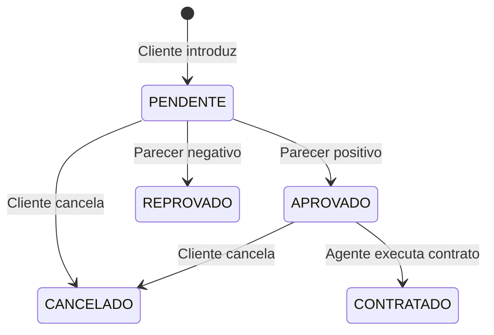

---

## ✨ Funcionalidades Principais

* 🔐 **Autenticação Segura:** cadastro prévio e login com usuário e senha (BCrypt + JWT); rotas protegidas por perfil (`CLIENTE` / `AGENTE`).
* 👤 **CRUD de Cliente:** cadastro (Create), consulta (Read), edição (Update) e exclusão (Delete) do próprio cadastro, com até 3 rendimentos.
* 📝 **Pedidos de Aluguel:** clientes introduzem, modificam, consultam e cancelam; agentes modificam e avaliam.
* 📊 **Análise Financeira:** agentes veem renda total, profissão e rendimentos do contratante e registram parecer positivo/negativo.
* 📄 **Execução de Contrato:** registro da propriedade do automóvel (cliente, empresa ou banco).
* 🏦 **Contrato de Crédito:** concedido apenas por bancos, com cálculo de parcela pela Tabela Price.
* 🚙 **Gestão de Automóveis:** matrícula, ano, marca, modelo e placa; disponibilidade atualizada automaticamente.
* 📈 **Painel:** contagem de pedidos por status e fila de trabalho do agente.

---

## 🛠 Tecnologias Utilizadas

### 💻 Front-end
* **Framework/Biblioteca:** React 19
* **Linguagem:** JavaScript (ES2022+) / JSX
* **Roteamento:** React Router 7
* **Estilização:** CSS puro com design tokens (variáveis CSS), responsivo
* **Gerenciamento de Estado:** Context API (`AuthContext`)
* **Build Tool:** Vite 7

### 🖥️ Back-end
* **Linguagem/Runtime:** Java 25 (JDK 25)
* **Framework:** Spring Boot 4.0.x (Spring MVC, Spring Data JPA, Bean Validation)
* **Banco de Dados:** Supabase (PostgreSQL); H2 em memória no perfil `local`
* **ORM:** Hibernate / JPA
* **Autenticação:** Spring Security + JWT (HS256, `spring-security-oauth2-resource-server`) + BCrypt
* **Build e dependências:** Apache Maven

### ⚙️ Infraestrutura & DevOps
* **Containerização:** Docker e Docker Compose
* **Cloud:** Supabase (banco gerenciado); sugestão de deploy: Vercel (front) e Render/Railway (API)

---

## 🏗 Arquitetura

O sistema segue o padrão **MVC** distribuído em **dois subsistemas**, conforme a especificação:

| Subsistema | Tecnologia | Papel no MVC |
|---|---|---|
| **Construção dinâmica das páginas web** | React + Vite (SPA) | **View** — renderiza as telas a partir dos dados da API |
| **Gestão de pedidos e contratos** | Spring Boot | **Controller** (`controller`) + **Model** (`service` + `model`) |
| **Persistência** | Supabase (PostgreSQL) | Armazenamento do Model via JPA |

**Fluxo de uma requisição:** página React → `services/api.js` (fetch + token JWT) → `@RestController` valida o DTO → `@Service` aplica as regras de negócio → `Repository` (Spring Data JPA) → Supabase. A resposta volta como DTO JSON e a View é re-renderizada.

**Padrões de projeto adotados**
* **Camadas / MVC:** `controller` → `service` → `repository` → `model`.
* **Repository** (Spring Data JPA) para acesso a dados.
* **Service Layer** concentrando casos de uso (ex.: `PedidoService.executarContrato`).
* **DTO** (records Java) separando contrato da API das entidades JPA.
* **Rich Domain Model:** regras de transição de status encapsuladas em `PedidoAluguel` (`avaliar`, `cancelar`, `marcarComoContratado`) e o limite de 3 rendimentos em `Cliente`.
* **Herança JOINED:** `Usuario` → `Cliente` / `Agente`.
* **Tratamento global de erros** (`@RestControllerAdvice`) com respostas JSON padronizadas.

**Decisões e trade-offs**
* API **stateless com JWT** em vez de sessão: simplifica a separação front/back e o deploy em domínios distintos.
* `Empresa` e `Banco` modelados como `TipoAgente` (enum) em vez de subclasses — não há comportamento distinto além da concessão de crédito (ver [histórico dos modelos](docs/uml/HISTORICO-MODELOS.md)).
* `ddl-auto=update` para agilidade no laboratório; o script SQL equivalente está em [`docs/database`](docs/database/schema-supabase.sql) para uso com `validate`.

### Modelagem (UML)

Fontes editáveis em [`docs/uml`](docs/uml) (Mermaid `.mmd` e PlantUML `.puml`). A versão inicial dos modelos está em [`docs/uml/v1-inicial`](docs/uml/v1-inicial) e as modificações estão justificadas em [HISTORICO-MODELOS.md](docs/uml/HISTORICO-MODELOS.md).

| Diagrama de Casos de Uso | Diagrama de Pacotes (Visão Lógica) |
|:---:|:---:|
| 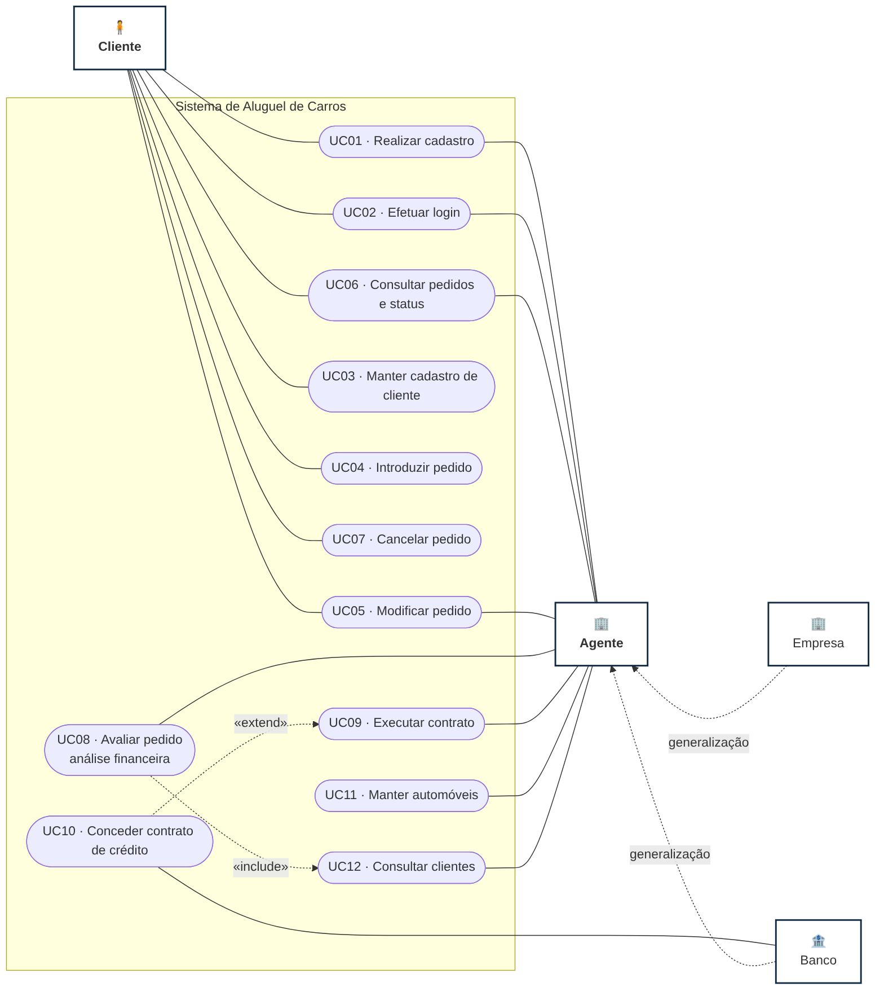 | 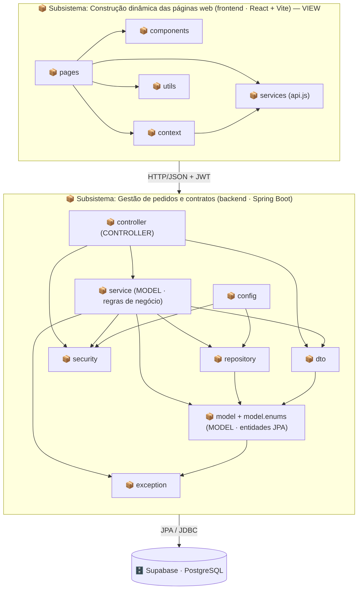 |

**Diagrama de Classes** (pacote `model`, espelhado 1:1 no código)

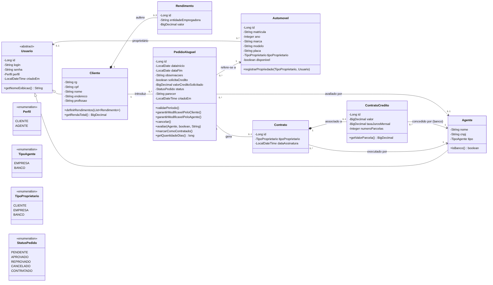

**Histórias do Usuário:** 13 histórias com critérios de aceitação e rastreamento para casos de uso e endpoints — [docs/historias-de-usuario.md](docs/historias-de-usuario.md).

### Mapa de endpoints da API

Base: `http://localhost:8080/api` · Autenticação: `Authorization: Bearer <token>`

| Método | Rota | Acesso | Descrição |
|---|---|---|---|
| POST | `/auth/login` | público | Login (retorna JWT) |
| POST | `/auth/registro/cliente` | público | Cadastro de cliente (Create do CRUD) |
| POST | `/auth/registro/agente` | público | Cadastro de agente (empresa/banco) |
| GET | `/auth/me` | autenticado | Usuário logado |
| GET | `/clientes` | agente | Lista clientes |
| GET | `/clientes/me` | cliente | Meus dados |
| GET | `/clientes/{id}` | próprio cliente / agente | Consulta cliente |
| PUT | `/clientes/{id}` | próprio cliente | Atualiza cadastro |
| DELETE | `/clientes/{id}` | próprio cliente | Exclui cadastro |
| GET | `/automoveis?disponiveis=true` | autenticado | Lista automóveis |
| POST / PUT / DELETE | `/automoveis[/{id}]` | agente | Mantém automóveis |
| GET | `/pedidos?status=` | autenticado | Cliente: os seus · Agente: todos |
| GET | `/pedidos/{id}` | dono / agente | Detalhe do pedido |
| POST | `/pedidos` | cliente | Introduz pedido |
| PUT | `/pedidos/{id}` | cliente (PENDENTE) / agente | Modifica pedido |
| PATCH | `/pedidos/{id}/cancelar` | cliente | Cancela pedido |
| PATCH | `/pedidos/{id}/avaliar` | agente | Parecer financeiro |
| POST | `/pedidos/{id}/contrato` | agente | Executa contrato (+ crédito) |
| GET | `/agentes` | autenticado | Lista agentes |
| GET | `/status` | público | Health check |

---

## 🔧 Instalação e Execução

### Pré-requisitos
* **Java JDK 25** (Back-end Spring Boot 4)
* **Apache Maven 3.9+**
* **Node.js** LTS (v20.19+ ou v22.12+, exigido pelo Vite 7) e **npm**
* Conta no **[Supabase](https://supabase.com)** (gratuita)
* Docker (opcional)

### 🔑 Variáveis de Ambiente

#### 1. Back-end (Spring Boot)
Copie `backend/.env.example` para `backend/.env` (o arquivo é lido automaticamente via `spring.config.import`) ou exporte as variáveis no sistema.

| Variável | Descrição | Exemplo |
|---|---|---|
| `SERVER_PORT` | Porta da API | `8080` |
| `SPRING_DATASOURCE_URL` | URL JDBC do Supabase (Session pooler) | `jdbc:postgresql://aws-0-sa-east-1.pooler.supabase.com:5432/postgres?sslmode=require` |
| `SPRING_DATASOURCE_USERNAME` | Usuário do banco | `postgres.abcdefghijklmnop` |
| `SPRING_DATASOURCE_PASSWORD` | Senha do banco | `senha-do-projeto` |
| `SPRING_JPA_DDL_AUTO` | Estratégia do schema | `update` |
| `JWT_SECRET` | Segredo de assinatura do JWT | `um-segredo-longo-e-aleatorio` |
| `JWT_EXPIRACAO_HORAS` | Validade do token | `8` |
| `CORS_ORIGENS` | Origens liberadas (vírgula) | `http://localhost:5173` |
| `APP_SEED_ENABLED` | Cria dados de demonstração se o banco estiver vazio | `true` |

#### 2. Front-end (React, Vite)
Copie `frontend/.env.example` para `frontend/.env.local`:

| Variável | Descrição | Exemplo |
|---|---|---|
| `VITE_API_URL` | URL base da API | `http://localhost:8080/api` |

> Variáveis do Vite precisam do prefixo `VITE_` para serem expostas ao código do cliente.

### 💾 Inicialização do Banco de Dados (Supabase · PostgreSQL)
1. Crie um projeto no Supabase.
2. Em **Project Settings → Database → Connection string**, copie a string **JDBC** do **Session pooler** (porta `5432`) — usuário no formato `postgres.<project-ref>`.
3. Preencha `backend/.env` com URL, usuário e senha.
4. **Schema:** com `SPRING_JPA_DDL_AUTO=update` o Hibernate cria as tabelas no primeiro start. Se preferir criar manualmente, rode [`docs/database/schema-supabase.sql`](docs/database/schema-supabase.sql) no **SQL Editor** e use `validate`.

> 💡 Para testar sem Supabase, use o perfil `local` (H2 em memória): `mvn spring-boot:run -Dspring-boot.run.profiles=local`.

### 📦 Instalação de Dependências
```bash
git clone <URL_DO_SEU_REPOSITÓRIO>
cd aluguel-carros

# Front-end
cd frontend && npm install && cd ..

# Back-end
cd backend && mvn clean install && cd ..
```

### ⚡ Como Executar a Aplicação

**Terminal 1 — Back-end (Spring Boot)**
```bash
cd backend
mvn spring-boot:run
```
🚀 API em `http://localhost:8080` (teste: `GET http://localhost:8080/api/status`).

**Terminal 2 — Front-end (React, Vite)**
```bash
cd frontend
npm run dev
```
🎨 Front-end em `http://localhost:5173`.

**Contas de demonstração** (criadas automaticamente com o banco vazio · senha `123456`):

| Usuário | Perfil |
|---|---|
| `cliente` | Cliente (Maria Silva, 2 rendimentos) |
| `locadora` | Agente · Empresa |
| `banco` | Agente · Banco |

### 🐳 Execução Local Completa com Docker Compose (Incluindo Banco de Dados)
Sobe PostgreSQL local + API + front-end (útil sem acesso ao Supabase):
```bash
docker compose up --build -d
docker ps
docker logs aluguel-carros-backend-1   # acompanhe a criação do schema
```
Acesse `http://localhost:5173`. Para parar: `docker compose down`.

---

## 🚀 Deploy
```bash
# 1. Front-end → gera /frontend/dist
cd frontend && npm run build

# 2. Back-end → gera /backend/target/aluguel-carros-1.0.0.jar
cd ../backend && mvn clean package

# 3. Execução da API
java -jar backend/target/aluguel-carros-1.0.0.jar
```
* **Front-end:** Vercel/Netlify servindo `dist/` com `VITE_API_URL` apontando para a API de produção (configure fallback de SPA para `index.html`).
* **Back-end:** Render/Railway (ou o `backend/Dockerfile`) com as variáveis `SPRING_DATASOURCE_*`, `JWT_SECRET` e `CORS_ORIGENS` (URL do front).
* **Banco:** Supabase.

---

## 📂 Estrutura de Pastas
```
.
├── README.md                         # 📘 Este documento
├── docker-compose.yml                # 🐳 PostgreSQL + API + Front (execução local)
├── .gitignore
│
├── backend/                          # 📁 Subsistema de gestão de pedidos e contratos (Spring Boot)
│   ├── pom.xml                       # 🛠️ Maven (Java 25, Spring Boot 4.0.x)
│   ├── Dockerfile
│   ├── .env.example                  # 🧩 Variáveis do Supabase/JWT
│   └── src/
│       ├── main/java/br/pucminas/aluguelcarros/
│       │   ├── AluguelCarrosApplication.java
│       │   ├── controller/           # 🎮 CONTROLLER: Auth, Cliente, Automovel, Pedido, Agente
│       │   ├── service/              # ⚙️ MODEL: regras de negócio (casos de uso)
│       │   ├── repository/           # 🗄️ Spring Data JPA
│       │   ├── model/                # 🧬 MODEL: entidades JPA (Usuario, Cliente, Agente, ...)
│       │   │   └── enums/            #     Perfil, TipoAgente, TipoProprietario, StatusPedido
│       │   ├── dto/                  # ✉️ Records de entrada/saída da API
│       │   ├── security/             # 🛡️ TokenService (JWT) e UsuarioLogado
│       │   ├── config/               # 🔧 SecurityConfig (CORS, JWT, BCrypt) e DataInitializer
│       │   └── exception/            # 💥 Exceções de negócio e handler global
│       ├── main/resources/
│       │   ├── application.yml       # ⚙️ Configuração (Supabase via variáveis)
│       │   └── application-local.yml # 🧪 Perfil H2 em memória
│       └── test/java/...             # 🧪 Testes unitários do domínio
│
├── frontend/                         # 📁 Subsistema de construção dinâmica das páginas (React + Vite) — VIEW
│   ├── package.json
│   ├── vite.config.js
│   ├── index.html
│   ├── Dockerfile
│   ├── .env.example
│   ├── public/logo.svg
│   └── src/
│       ├── main.jsx / App.jsx        # 🚦 Rotas (públicas e protegidas por perfil)
│       ├── pages/                    # 📄 Login, Cadastro, Dashboard, Pedidos, PedidoForm,
│       │                             #    PedidoDetalhe, Automoveis, Clientes, Perfil
│       ├── components/               # 🧱 Layout, ProtectedRoute, ClienteForm, StatusBadge, ...
│       ├── context/                  # 🔐 AuthContext (sessão/JWT)
│       ├── services/api.js           # 🔌 Chamadas HTTP à API
│       ├── utils/format.js           # 🛠️ Formatação (moeda, datas, CPF/CNPJ)
│       └── styles/global.css         # 🎨 Design tokens e estilos
│
└── docs/
    ├── historias-de-usuario.md       # 📋 13 histórias com critérios de aceitação
    ├── database/schema-supabase.sql  # 💾 Script do banco
    ├── screenshots/                  # 🖼️ Capturas de tela
    └── uml/                          # 📐 Modelos UML (todas as versões)
        ├── HISTORICO-MODELOS.md      #    Comparação v1 → v2 e justificativas
        ├── v1-inicial/               #    Modelagem inicial
        ├── plantuml/                 #    Fontes PlantUML (casos de uso, classes, pacotes)
        ├── img/                      #    Diagramas renderizados (PNG/SVG)
        └── *.mmd                     #    Fontes Mermaid
```

---

## 🎥 Demonstração

### 🌐 Aplicação Web

| Login | Cadastro |
|:---:|:---:|
| 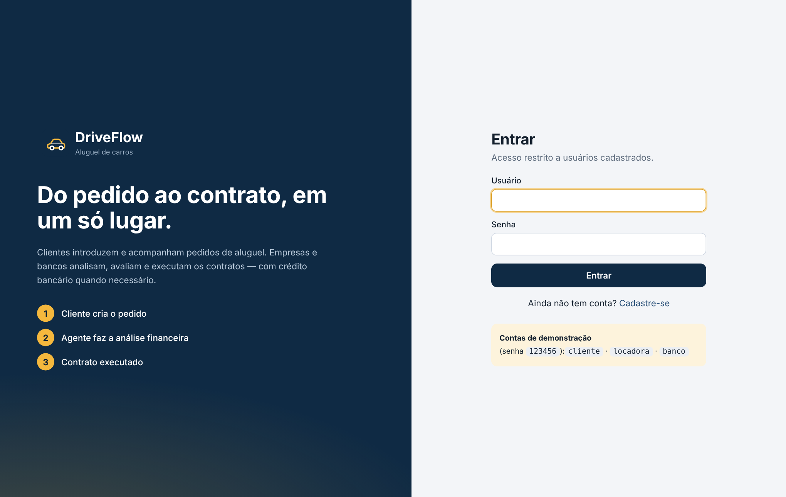 | 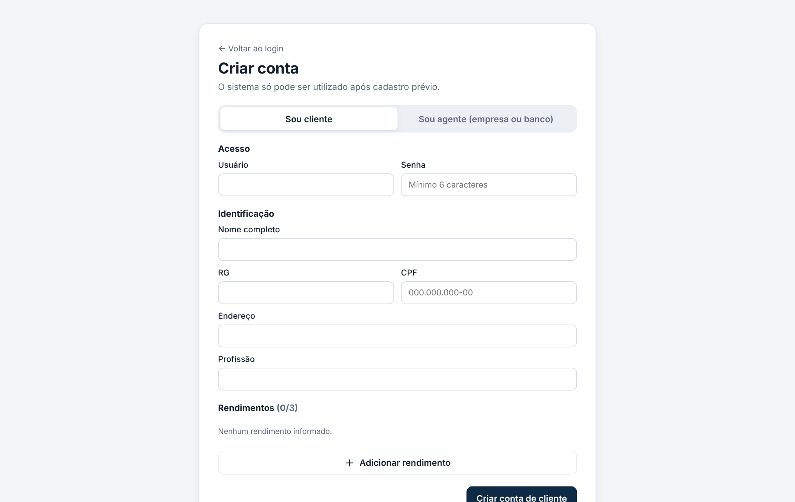 |
| **Painel do Cliente** | **Novo pedido** |
| 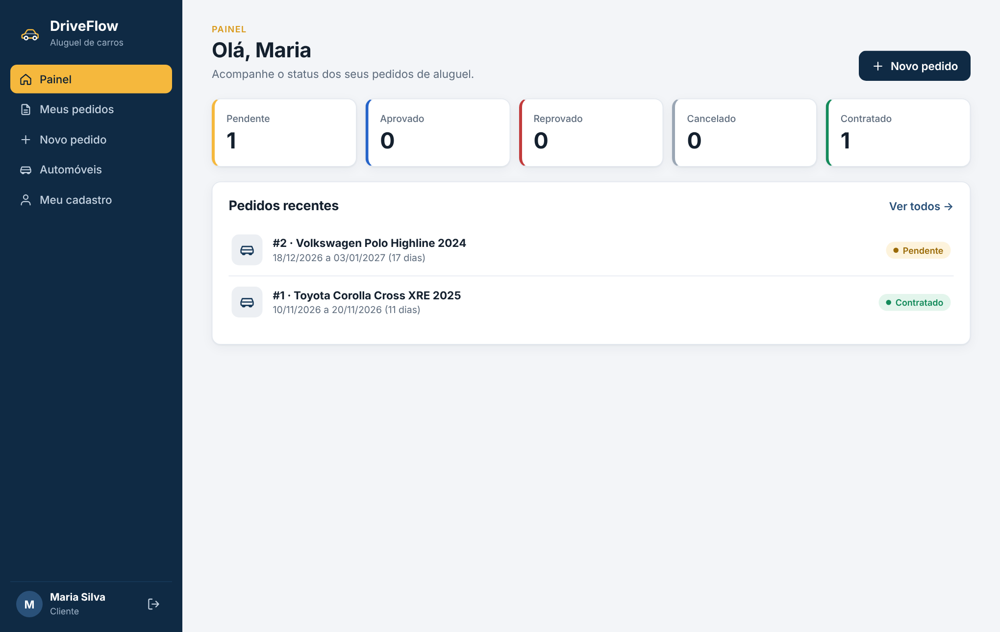 | 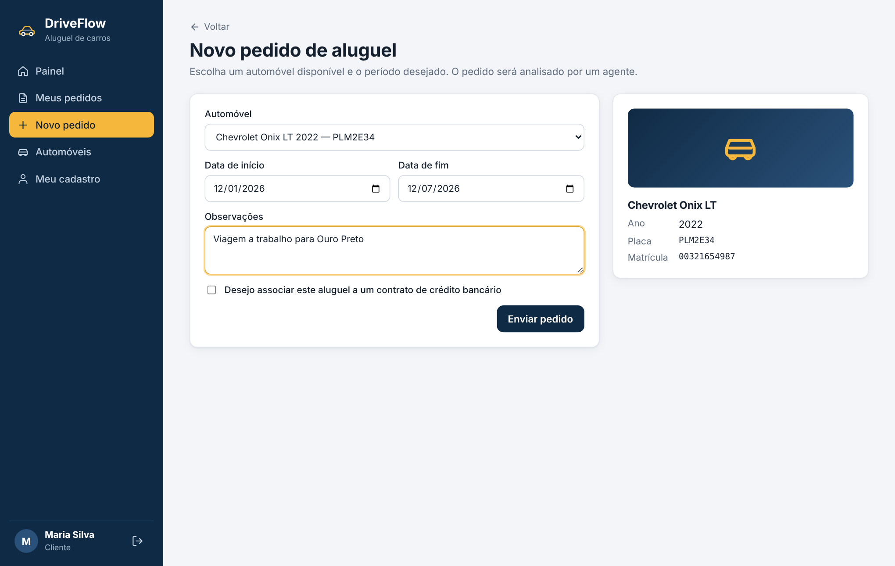 |
| **Meus pedidos (status)** | **Meu cadastro (CRUD de cliente)** |
| 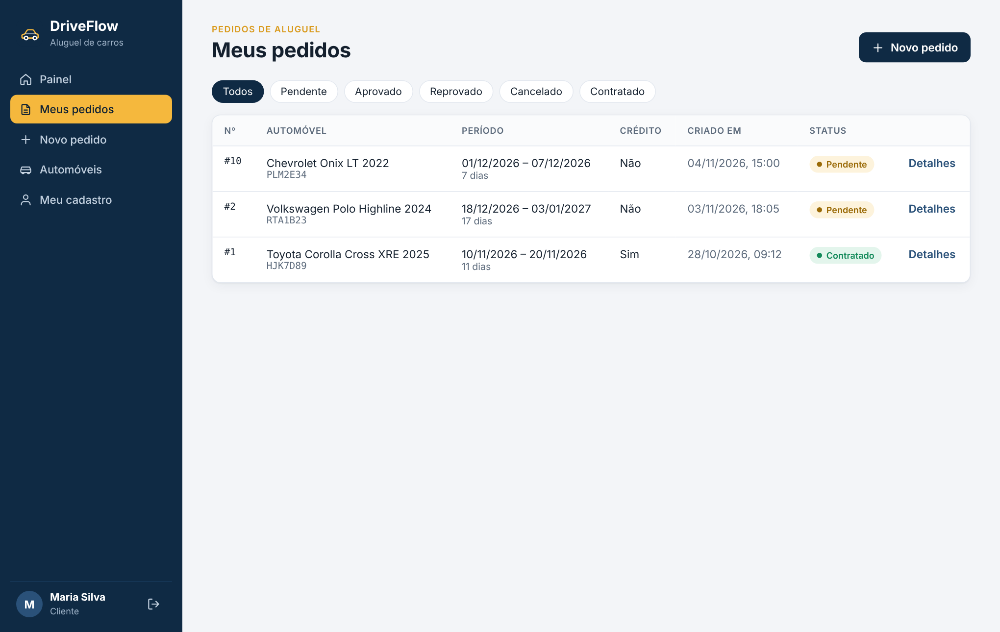 | 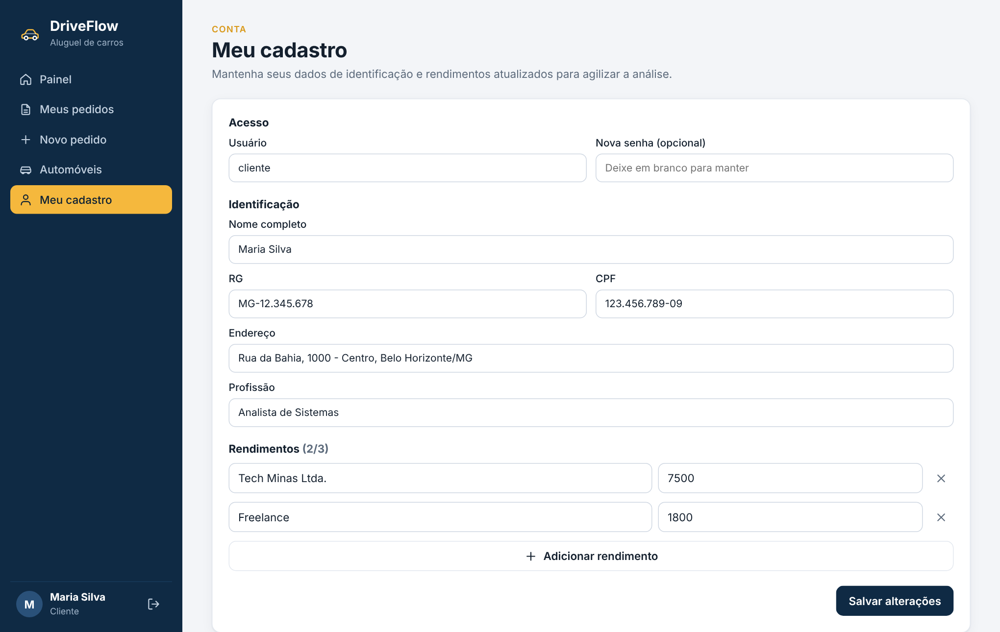 |
| **Agente: avaliação financeira** | **Agente: execução do contrato** |
| 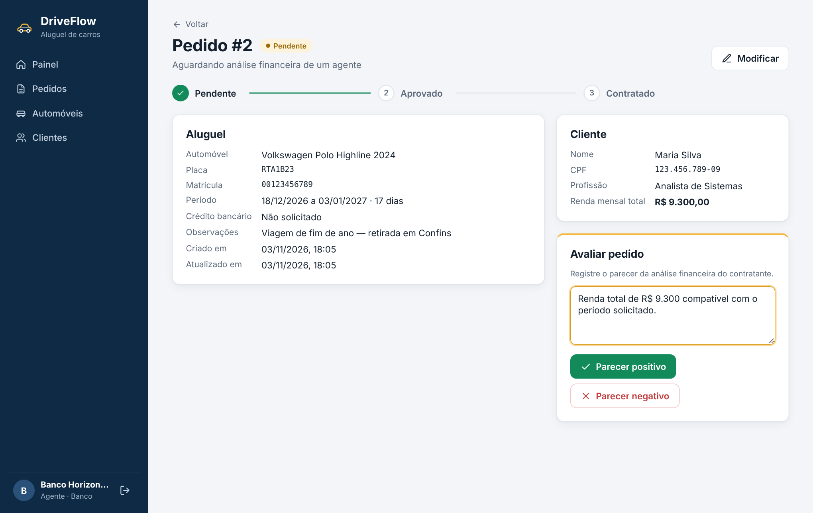 | 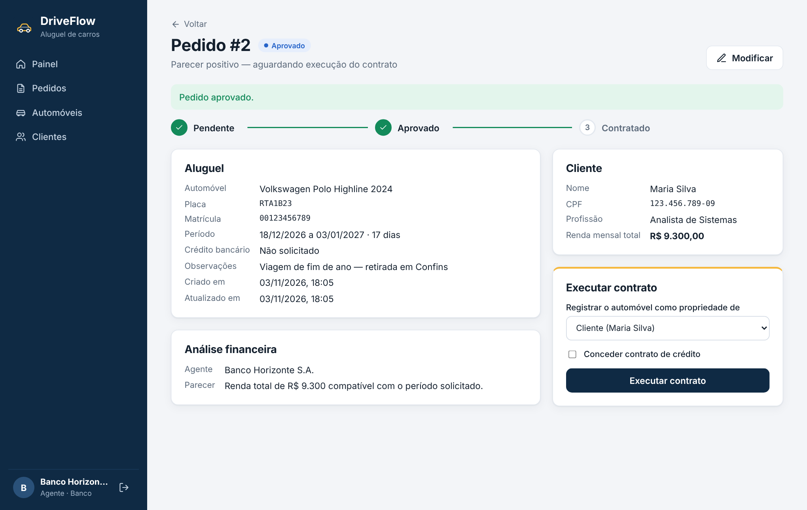 |
| **Contrato com crédito bancário** | **Automóveis** |
| 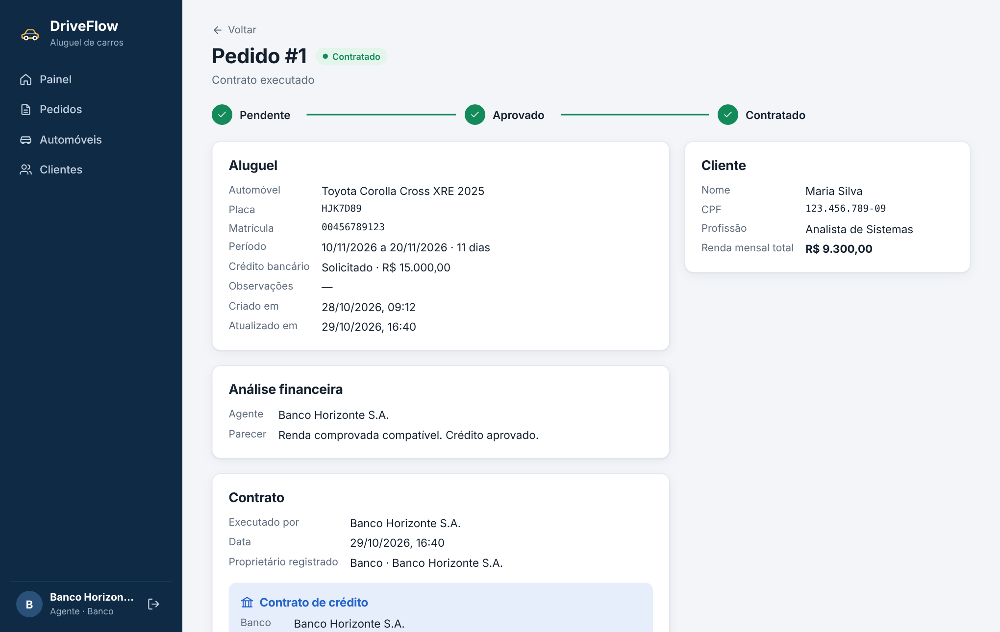 | 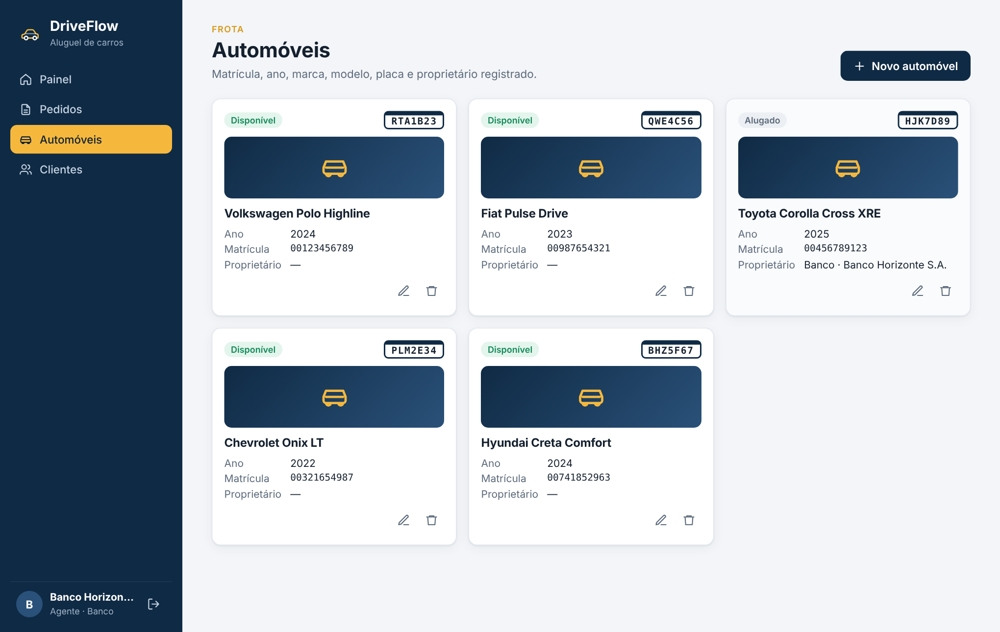 |

### 💻 Exemplo de Saída no Terminal (API)

```bash
# 1) Login
curl -s -X POST http://localhost:8080/api/auth/login \
     -H 'Content-Type: application/json' \
     -d '{"login":"cliente","senha":"123456"}'
```
```json
{
  "token": "eyJhbGciOiJIUzI1NiJ9...",
  "tipo": "Bearer",
  "expiraEm": "2026-11-05T02:00:00Z",
  "usuario": { "id": 3, "login": "cliente", "nome": "Maria Silva", "perfil": "CLIENTE", "tipoAgente": null }
}
```
```bash
# 2) Introduzir pedido
curl -s -X POST http://localhost:8080/api/pedidos \
     -H "Authorization: Bearer $TOKEN" -H 'Content-Type: application/json' \
     -d '{"automovelId":1,"dataInicio":"2026-12-01","dataFim":"2026-12-07","solicitaCredito":false}'
```
```json
{ "id": 1, "status": "PENDENTE", "dataInicio": "2026-12-01", "dataFim": "2026-12-07", "quantidadeDias": 7,
  "cliente": { "id": 3, "nome": "Maria Silva", "rendaTotal": 9300.00 },
  "automovel": { "id": 1, "marca": "Volkswagen", "modelo": "Polo Highline", "placa": "RTA1B23", "disponivel": true },
  "contrato": null }
```
Erro de regra de negócio (HTTP 422):
```json
{ "status": 422, "erro": "Unprocessable Entity", "mensagem": "Só é possível avaliar pedidos com status PENDENTE." }
```

---

## 🧪 Testes

### Testes Unitários (Back-end)
```bash
cd backend
mvn test
```
Ferramenta: **JUnit 5** (via `spring-boot-starter-test`). Cobrem as regras de domínio: transições de status do pedido, validação de período, limite de 3 rendimentos e cálculo da parcela do crédito (Tabela Price).

### Roteiro de teste manual (E2E)
1. Login como `cliente` → **Novo pedido** → enviar → status **Pendente**.
2. Login como `banco` → abrir o pedido → **Parecer positivo** → **Executar contrato** (com ou sem crédito).
3. Login como `cliente` → pedido aparece como **Contratado**, com dados do contrato e do crédito.

---

## 🔗 Documentações utilizadas
* 📖 [Spring Boot — Documentação Oficial](https://docs.spring.io/spring-boot/index.html)
* 📖 [Spring Security — Resource Server JWT](https://docs.spring.io/spring-security/reference/servlet/oauth2/resource-server/jwt.html)
* 📖 [Spring Data JPA](https://docs.spring.io/spring-data/jpa/reference/)
* 📖 [Supabase — Conectando ao banco (Postgres)](https://supabase.com/docs/guides/database/connecting-to-postgres)
* 📖 [React](https://react.dev/) · [React Router](https://reactrouter.com/) · [Vite](https://vite.dev/guide/)
* 📖 [Mermaid](https://mermaid.js.org/) · [PlantUML](https://plantuml.com/)
* 📖 [Conventional Commits](https://www.conventionalcommits.org/pt-br/)

---

## 👥 Autores

| 👤 Nome | :octocat: GitHub | 💼 LinkedIn | 📤 Gmail |
|---|---|---|---|
| Iury Emanuel Alves da Silva | [@IRZN](https://github.com/IRZN) | [LinkedIn](https://www.linkedin.com/in/iury-emanuel-127b7b2b5) | [iuryemanuel220@gmail.com](mailto:iuryemanuel220@gmail.com) |

---

## 🤝 Contribuição
1. Faça um **fork** do projeto.
2. Crie uma branch: `git checkout -b feature/minha-feature`.
3. Commit seguindo Conventional Commits: `git commit -m 'feat: adiciona filtro de pedidos por período'`.
4. Push: `git push origin feature/minha-feature`.
5. Abra um **Pull Request**.

---

## 🙏 Agradecimentos
* **Engenharia de Software PUC Minas** — pelo apoio institucional e estrutura acadêmica.
* **Prof. Dr. João Paulo Aramuni** — pelos ensinamentos sobre Arquitetura de Software, Padrões de Projeto e pelo template deste README.

---

## 📄 Licença
Este projeto é distribuído sob a **Licença MIT**.